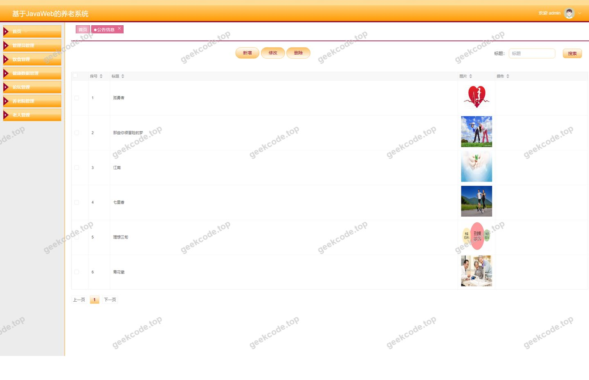
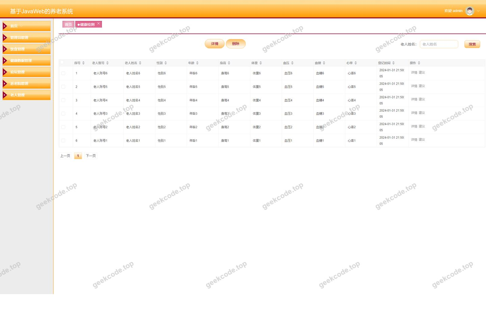
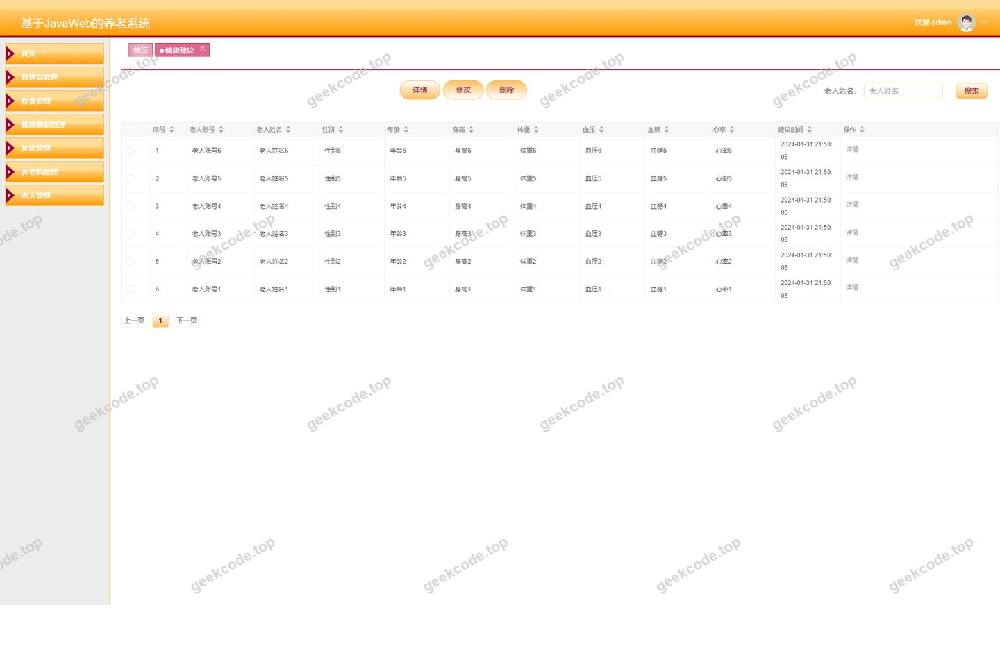
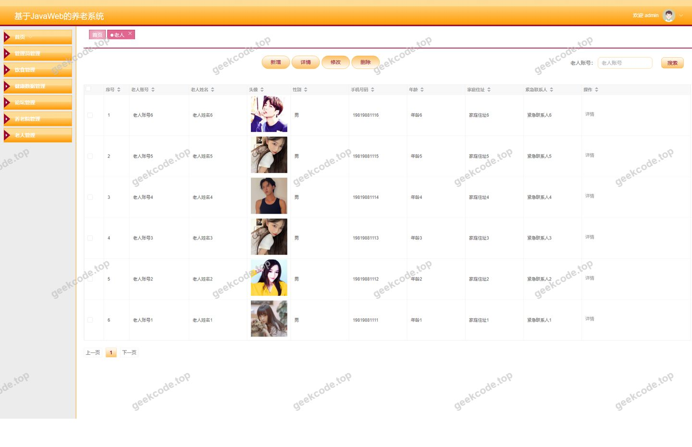
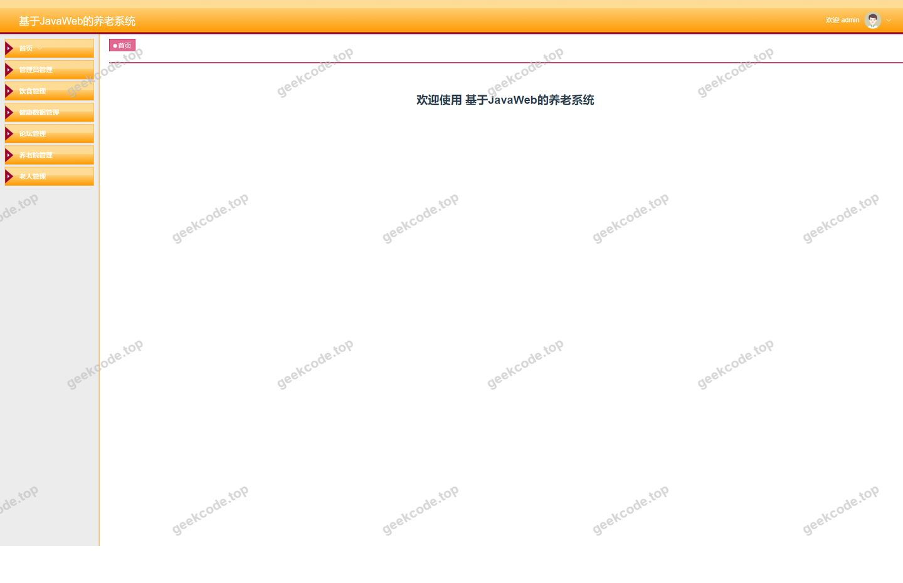
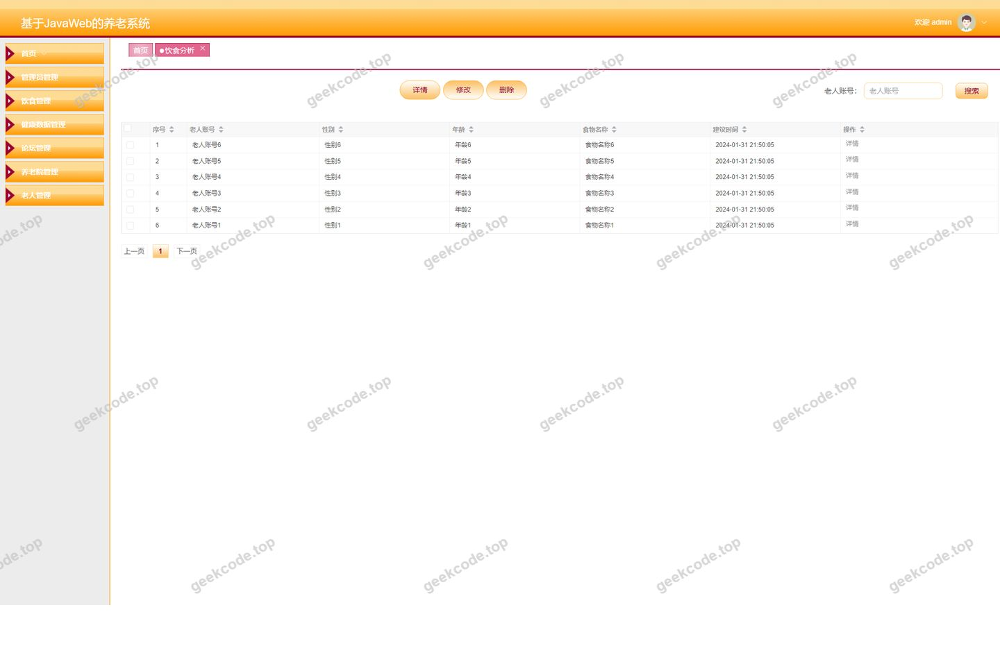
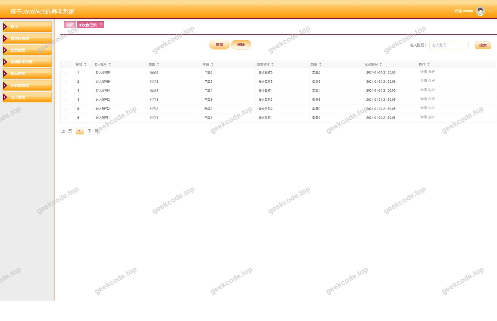

# 基于JavaWeb的养老系统

> 🎓 **计算机毕业设计 · 基于JavaWeb的养老系统**
>
> 本仓库只放**项目介绍 + 运行截图**（截图是站点带水印的原图，存在仓库 `images/` 里）。
>
> 👉 **完整可运行源码 / 数据库脚本 / 部署文档：[点我获取](https://geekcode.top/archives/%E5%9F%BA%E4%BA%8EJavaWeb%E7%9A%84%E5%85%BB%E8%80%81%E7%B3%BB%E7%BB%9F?utm_source=github)**
>
> 💬 咨询微信：**ir9372**　|　🌐 更多项目：[极客代码 geekcode.top](https://geekcode.top/?utm_source=github)
>
> 📌 项目详情页：<https://geekcode.top/archives/%E5%9F%BA%E4%BA%8EJavaWeb%E7%9A%84%E5%85%BB%E8%80%81%E7%B3%BB%E7%BB%9F?utm_source=github>

<table><td width="230" align="center"> <b>扫码加微信 ir9372</b></td><td valign="middle">📦 源码 = 项目介绍 + 全部运行截图 + 数据库 + 部署文档 👉 点上方任意截图，直接跳到 <b>极客代码 geekcode.top</b> 详情页</td></table>

---

<h1>基于JavaWeb的养老系统</h1>
<h2>项目概述</h2>

本项目名为“基于JavaWeb的养老系统”，旨在构建一个集老人信息管理、健康监测、饮食记录与分析于一体的综合性服务平台。系统采用前后端分离架构，服务于养老机构管理人员及入住老人或家属。核心功能涵盖老人档案维护、健康检测数据录入、饮食记录追踪、饮食分析报告生成以及健康建议发布等模块。通过数字化手段解决传统养老管理中信息分散、健康数据难以量化分析的问题，提升养老服务效率与质量。适用场景为中小型养老院、社区养老服务中心，目标用户包括机构管理员、医护人员及老人及其家属。技术架构上，后端基于 Spring Boot 框架结合 MyBatis-Plus 进行高效数据持久化操作，使用 Shiro 实现安全权限控制；前端采用 Vue.js 框架构建响应式界面，确保良好的用户体验。

<h2>技术架构</h2>

本项目采用经典的前后端分离开发模式，整体架构清晰，职责明确。

<strong>1. 后端架构</strong>
后端服务基于 <strong>Spring Boot</strong> 框架构建，利用其自动配置特性简化开发流程。数据访问层采用 <strong>MyBatis-Plus</strong>，在保留 MyBatis 灵活性的基础上提供了通用的 CRUD 接口和分页插件，显著提升开发效率。数据库选用 <strong>MySQL</strong> 存储业务数据。安全框架集成 <strong>Apache Shiro</strong>，负责系统的身份认证与授权管理，确保不同角色用户只能访问其权限范围内的资源。此外，引入了 <code>spring-boot-starter-web</code> 处理 HTTP 请求，<code>validation-api</code> 用于参数校验，<code>commons-lang3</code> 提供常用工具类支持。

<strong>2. 前端架构</strong>
前端采用 <strong>Vue.js</strong> 生态体系（vue-separate 类型），通过 Axios 异步请求与后端 API 进行数据交互。页面组件化设计提高了代码复用性和可维护性。路由管理区分前台用户视图与后台管理视图，确保导航逻辑清晰。

<strong>3. 数据库设计要点</strong>
数据库围绕核心业务实体设计，主要表结构包括：

<ul>
<li><strong>用户与权限表</strong>：存储管理员及普通用户账号信息，关联 Shiro 权限角色。</li>
<li><strong>老人信息表 (laoren)</strong>：记录老人的基本档案、联系方式及入住状态。</li>
<li><strong>健康检测表 (jiankangjiance)</strong>：存储血压、心率等定期监测数据。</li>
<li><strong>饮食记录表 (yinshijilu)</strong>：记录每餐的饮食内容、时间及分量。</li>
<li><strong>饮食分析表 (yinshifenxi)</strong>：基于饮食记录生成的营养摄入分析报告。</li>
<li><strong>健康建议表 (jiankangjianyi)</strong>：存储针对特定健康状况的专业建议。</li>
<li><strong>公告与信息表 (news/forum)</strong>：用于发布系统通知及交流论坛内容。</li>
<li><strong>配置表 (config)</strong>：存储系统全局参数设置。</li>
</ul>
<h2>功能模块</h2>

系统分为前台用户端和后台管理端两个主要部分，各模块功能如下：

<h3>前台用户端</h3>

前台面向老人、家属或公众开放，提供信息查询与服务入口：

<ol>
<li><strong>首页展示</strong>：展示最新公告新闻 (<code>/index/newsList</code>) 及论坛动态 (<code>/index/forumList</code>)。</li>
<li><strong>老人信息管理</strong>：</li>
</ol>
<ul>
<li>查看老人列表 (<code>/index/laorenList</code>) 及详细信息 (<code>/index/laorenDetail</code>)。</li>
<li>注册新用户 (<code>/laorenRegister</code>)。</li>
<li>个人中心入口 (<code>/index/laorenCenter</code>)。</li>
</ul>
<ol start="3">
<li><strong>健康监测服务</strong>：</li>
</ol>
<ul>
<li>查看健康检测记录列表 (<code>/index/jiankangjianceList</code>) 及详情 (<code>/index/jiankangjianceDetail</code>)。</li>
<li>新增健康检测数据 (<code>/index/jiankangjianceAdd</code>)。</li>
</ul>
<ol start="4">
<li><strong>饮食管理服务</strong>：</li>
</ol>
<ul>
<li><strong>饮食记录</strong>：查看历史饮食记录 (<code>/index/yinshijiluList</code>, <code>/index/yinshijiluDetail</code>) 并添加新记录 (<code>/index/yinshijiluAdd</code>)。</li>
<li><strong>饮食分析</strong>：查看饮食分析报告 (<code>/index/yinshifenxiList</code>, <code>/index/yinshifenxiDetail</code>) 并可发起新的分析任务 (<code>/index/yinshifenxiAdd</code>)。</li>
<li><strong>饮食提醒</strong>：查看饮食相关提醒信息 (<code>/index/yinshitixingList</code>, <code>/index/yinshitixingDetail</code>) 及管理提醒设置 (<code>/index/yinshitixingAdd</code>)。</li>
</ul>
<ol start="5">
<li><strong>健康咨询与建议</strong>：</li>
</ol>
<ul>
<li>浏览健康建议文章 (<code>/index/jiankangjianyiList</code>, <code>/index/jiankangjianyiDetail</code>)。</li>
<li>提交个人健康建议或问题 (<code>/index/jiankangjianyiAdd</code>)。</li>
</ul>
<ol start="6">
<li><strong>紧急通知</strong>：</li>
</ol>
<ul>
<li>查看紧急通知列表 (<code>/index/jinjitongzhiList</code>) 及详情 (<code>/index/jinjitongzhiDetail</code>)。</li>
</ul>
<ol start="7">
<li><strong>养老院信息</strong>：</li>
</ol>
<ul>
<li>查看养老院介绍及设施列表 (<code>/index/yanglaoyuanList</code>, <code>/index/yanglaoyuanDetail</code>)。</li>
</ul>
<h3>后台管理端</h3>

后台面向管理员，提供全面的数据管理与系统配置功能：

<ol>
<li><strong>登录管理</strong>：管理员通过专用登录页进入系统。</li>
<li><strong>首页概览</strong>：展示关键数据统计及快捷入口。</li>
<li><strong>基础信息管理</strong>：</li>
</ol>
<ul>
<li><strong>老人管理</strong>：增删改查老人档案 (<code>/laoren</code>)。</li>
<li><strong>养老院管理</strong>：维护养老院基本信息及宣传内容 (<code>/yanglaoyuan</code>)。</li>
</ul>
<ol start="4">
<li><strong>健康与饮食数据管理</strong>：</li>
</ol>
<ul>
<li><strong>健康检测</strong>：审核与管理所有用户的健康检测数据 (<code>/jiankangjiance</code>)。</li>
<li><strong>饮食记录</strong>：监控和管理饮食记录数据 (<code>/yinshijilu</code>)。</li>
<li><strong>饮食分析</strong>：管理生成的饮食分析报告 (<code>/yinshifenxi</code>)。</li>
<li><strong>饮食提醒</strong>：配置和发送饮食相关的系统提醒 (<code>/yinshitixing</code>)。</li>
<li><strong>健康建议</strong>：发布和管理专业健康建议内容 (<code>/jiankangjianyi</code>)。</li>
</ul>
<ol start="5">
<li><strong>内容与互动管理</strong>：</li>
</ol>
<ul>
<li><strong>公告新闻</strong>：发布和维护系统公告及新闻 (<code>/news</code>)。</li>
<li><strong>论坛管理</strong>：审核帖子、管理用户评论及板块设置 (<code>/forum</code>)。</li>
</ul>
<ol start="6">
<li><strong>系统设置</strong>：</li>
</ol>
<ul>
<li><strong>用户管理</strong>：管理系统账户及权限分配 (<code>/users</code>)。</li>
<li><strong>配置管理</strong>：修改系统全局参数 (<code>/config</code>)。</li>
</ul>
<h2>用户角色与权限</h2>

根据系统设计及路由结构，主要存在两类用户角色：

<strong>1. 管理员 (Admin)</strong>

<ul>
<li><strong>权限范围</strong>：拥有系统最高权限，可访问所有后台管理路由。</li>
<li><strong>具体功能</strong>：</li>
<li>完整 CRUD（创建、读取、更新、删除）操作：老人信息、健康检测数据、饮食记录、饮食分析、饮食提醒、健康建议、公告新闻、论坛内容、养老院信息。</li>
<li>系统配置：管理用户账号、修改系统参数。</li>
<li>数据审核：对前台提交的敏感数据进行审核或管理。</li>
</ul>

<strong>2. 普通用户 (老人/家属)</strong>

<ul>
<li><strong>权限范围</strong>：仅能访问前台路由，且通常受限于自身数据的可见性与编辑权。</li>
<li><strong>具体功能</strong>：</li>
<li><strong>浏览</strong>：查看公告、论坛、健康建议、养老院介绍、紧急通知。</li>
<li><strong>个人信息管理</strong>：注册账号、查看自己的老人档案详情、进入个人中心。</li>
<li><strong>数据录入与查询</strong>：</li>
<li>添加和查看个人的健康检测记录。</li>
<li>添加和查看个人的饮食记录。</li>
<li>发起饮食分析请求并查看结果。</li>
<li>接收和管理个人的饮食提醒。</li>
<li>提交健康建议或参与论坛讨论。</li>
<li><strong>限制</strong>：无法访问后台管理界面，无法修改他人数据或系统配置。</li>
</ul>
<h2>项目特色与创新点</h2>
<ol>
<li>
<strong>闭环的健康饮食管理体系</strong>：
   项目不仅记录了“饮食”和“健康检测”两个独立维度，还通过“饮食分析”模块将二者关联。系统能够基于饮食记录生成分析报告，并结合健康建议模块提供个性化的指导，形成了从数据采集到分析再到建议反馈的完整闭环，优于传统的单一记录型系统。

</li>
<li>
<strong>精细化的提醒机制</strong>：
   引入独立的“饮食提醒”模块，区别于普通的公告新闻。该功能允许针对特定时间或特定人群推送饮食相关的注意事项，体现了系统在主动干预和服务人性化方面的考量。

</li>
<li>
<strong>前后端分离的安全架构</strong>：
   采用 Vue + Spring Boot 的主流技术栈，结合 Shiro 进行细粒度的权限控制。这种架构不仅提升了系统的并发处理能力和用户体验，还确保了医疗/健康数据这类敏感信息的访问安全性，符合现代 Web 应用的标准规范。

</li>
<li>
<strong>多维度的信息发布渠道</strong>：
   整合了公告新闻、论坛、紧急通知和健康建议四种不同的内容形态。分别对应官方通告、社区交流、突发事件预警和专业科普，满足了养老场景中不同层次的信息传播需求。

</li>
</ol>
<h2>部署环境</h2>

为确保系统正常运行，需准备以下软件环境：

<ol>
<li><strong>操作系统</strong>：Windows 10/11, Linux (CentOS/Ubuntu), 或 macOS。</li>
<li><strong>Java 运行环境</strong>：JDK 1.8 或更高版本（推荐 JDK 8）。</li>
<li><strong>数据库</strong>：MySQL 5.7 或 MySQL 8.0。需安装 MySQL Server 客户端工具以导入初始 SQL 脚本。</li>
<li><strong>Maven</strong>：Apache Maven 3.6+，用于后端项目的依赖管理和构建。</li>
<li><strong>Node.js</strong>：Node.js 14.x 或 16.x LTS 版本，配合 npm 或 yarn 包管理器，用于前端 Vue 项目的依赖安装与打包编译。</li>
<li><strong>浏览器</strong>：Chrome, Firefox, Edge 等主流现代浏览器（建议使用 Chrome 以获得最佳兼容性）。</li>
<li><strong>IDE（开发阶段）</strong>：IntelliJ IDEA (后端), VS Code (前端)。</li>
</ol>
<h2>五、技术特性</h2>
<ul>
<li>前后端分离架构，前端独立部署</li>
<li>使用 MyBatis-Plus 简化数据访问层开发</li>
<li>集成 Shiro 权限框架实现角色权限控制</li>
</ul>
<h2>六、功能模块截图</h2>
<h3>后台管理端</h3>
<h4>后台-登录页</h4>

<h4>后台-公告信息</h4>

<h4>后台-健康检测</h4>

<h4>后台-健康建议</h4>

<h4>后台-老人</h4>

<h4>页面-首页</h4>

<h4>后台-饮食分析</h4>

<h4>后台-饮食记录</h4>

---

## 获取完整源码

| 项目 | 说明 |
| --- | --- |
| 项目名 | 基于JavaWeb的养老系统 |
| 运行截图 | 本文 8 张（站点带水印原图，仓库 `images/` 目录） |
| 完整源码 | [https://geekcode.top/archives/%E5%9F%BA%E4%BA%8EJavaWeb%E7%9A%84%E5%85%BB%E8%80%81%E7%B3%BB%E7%BB%9F?utm_source=github](https://geekcode.top/archives/%E5%9F%BA%E4%BA%8EJavaWeb%E7%9A%84%E5%85%BB%E8%80%81%E7%B3%BB%E7%BB%9F?utm_source=github) |
| 咨询微信 | **ir9372**（备注：jingpin-yuanma） |
| 更多项目 | [极客代码 geekcode.top](https://geekcode.top/?utm_source=github) |

> 需要源码、部署、改配置、跑不起来等问题，加微信 ir9372 沟通，说明项目名即可。
